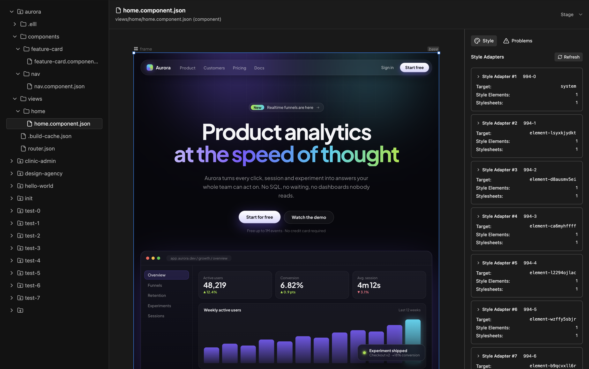
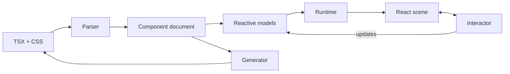

# Elementa

Elementa is a visual development engine for React. It represents TSX components as structured, reactive documents that can be rendered and edited visually, then transformed back into code.

The project brings together a component compiler, document and runtime models, a React rendering engine, and an interaction layer. Elementa Studio provides a workspace for exploring projects, previewing components, and working with the canvas.

<p align="center">
  
</p>

*Elementa Studio with the Aurora sample project. The project explorer is on the left, the component stage is in the center, and the stylesheet inspector is on the right.*

## Getting started

Requires Node.js 20 or later and pnpm 10.

```bash
pnpm install
pnpm build
pnpm test
pnpm studio
```

`pnpm studio` compiles the sample projects and starts the development environment:

| Service | Address | Purpose |
| --- | --- | --- |
| Studio | `http://localhost:3500` | Project explorer, component viewer, stage, and inspector |
| Canvas runtime | `http://localhost:5174` | Renders components in the Studio iframe |
| Studio server | `http://localhost:3000` | Serves project files and broadcasts changes over SSE |

To explore the canvas, open `aurora/views/home/home.component.json` in Studio and select **Stage**. Use Ctrl/⌘ + scroll to zoom. The `design-agency` project provides another set of components and views to explore.

## Architecture

Elementa's component representation sits between source code and the rendered interface:



### Component transformation

[`packages/framework/transformers`](packages/framework/transformers) uses `ts-morph` to parse TSX and CSS into the component document format. The document includes typed elements, component state, fragments, styles, and other information needed by the runtime and editor. The generator handles the reverse transformation, producing TSX from component data.

### Models and state

[`packages/engine/models`](packages/engine/models) defines components, elements, routes, stylesheets, and related domain models. RxJS observables expose updates to the renderer and editing tools. The [`kernel`](packages/engine/kernel) provides lifecycle management, state abstractions, and reconciliation utilities; [`backends/json`](packages/engine/backends/json) is the reference state backend.

### Runtime and rendering

[`packages/engine/runtime`](packages/engine/runtime) resolves component inputs, state, expressions, slots, and styles in scoped environments. It also includes a browser module manager for evaluating user modules.

[`packages/engine/scene`](packages/engine/scene) maps runtime instances into React-rendered content within stages, frames, and viewports. Its stylesheet manager maintains DOM style elements and keeps CSS rules synchronized with the underlying models.

### Visual editing

[`packages/engine/interactor`](packages/engine/interactor) provides the editing layer over the rendered content: selection, handles, tools, text editing, and pointer interactions. Editing operations update the document model, and the reactive pipeline propagates those changes to the rendered scene.

## Repository structure

```text
apps/
  studio-client/       Studio interface and project explorer
  studio-server/       Project API, file watching, and SSE updates
  elementa/            Canvas runtime hosted inside Studio

packages/
  schema/
    base/              Component and application document schemas
    css/               CSS schema and serialization
  engine/
    kernel/            State interfaces, lifecycle, reconciliation
    backends/          JSON and experimental CRDT backends
    models/            Reactive document models
    runtime/           Component instances and runtime environments
    scene/             React rendering and DOM stylesheets
    interactor/        Canvas interactions and editing tools
    tests/             Node and browser integration tests
  framework/
    transformers/      TSX/CSS parsing and generation
    assembler/         Application assembly and generation
  utils/               Shared language, geometry, and React utilities

playground/             Example projects and compilation tooling
```

## Examples

The [`playground/projects`](playground/projects) directory contains sample applications and components used to exercise the compiler and renderer. These include `aurora`, `design-agency`, and smaller test projects.

<p align="center">
  
</p>

Source components can use co-located CSS exports or imported `.component.css` files. The compiler translates their styles into the document model, including supported conditional classes and responsive  rules.

## Development and testing

The workspace uses TypeScript, React, RxJS, Vite, Turborepo, and pnpm. The transformer test fixtures cover parsing, code generation, and normalization; engine tests cover state, rendering, and integration behavior.

```bash
pnpm build
pnpm test
```

Some additional integration suites use an older project file format and are excluded from the default test run. Their configuration is in [`packages/engine/tests/node/vite.config.ts`](packages/engine/tests/node/vite.config.ts); they can be run separately with:

```bash
pnpm --filter @elllphnt/elementa-tests-node test:all
```

## Project status

Elementa is an experimental codebase under active development, rather than a finished editor. Some parts of the system are further along than others:

- **Interaction tools:** `interactor/src` is the newer implementation of the editing layer. The previous implementation remains under [`interactor/__`](packages/engine/interactor/__) for reference. Element-level resize, padding, and gap controls have not all been migrated into the newer layer.
- **Collaboration:** The Yjs-based CRDT backend is paused while its state implementation is adapted to the current kernel interfaces. It is not part of the default build.
- **Component parsing:** Markup in certain early-return branches can be represented as computed expressions instead of individually editable element nodes.
- **Older examples:** Some playground projects still use legacy inline styling or external utility classes that the current compiler does not fully process.

The current focus is on consolidating the component model, renderer, and interaction layer while preserving the ability to move between source code and visual documents.